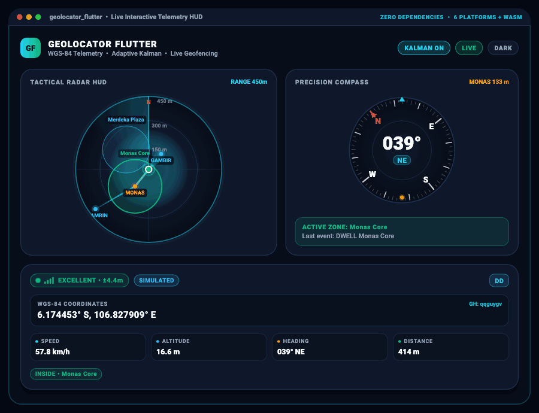

<p align="center">
  <a href="https://pub.dev/packages/flutter_geolocation">
    
  </a>
</p>

<h1 align="center">flutter_geolocation</h1>

<p align="center">
  <strong>Modern, lightweight, ultra-accurate geolocation toolkit for Flutter — with zero third-party dependencies, WGS-84 geodesy, adaptive Kalman smoothing, circular &amp; polygonal geofencing, track recording, and pure-widget HUD instruments.</strong>
</p>

<p align="center">
  <a href="https://pub.dev/packages/flutter_geolocation"></a>
  <a href="https://pub.dev/packages/flutter_geolocation/score"></a>
  
  
  
  <a href="https://opensource.org/licenses/MIT"></a>
</p>

<p align="center">
  Supported by <a href="https://humanize.id"><strong>Humanize AI</strong></a> · <a href="https://github.com/andikpbw/flutter-geolocation">GitHub Repository</a>
</p>

---

## Live Interactive UI Preview

Real Flutter widgets (`GeoRadarWidget`, `GeoCompassWidget`, `GeoTelemetryCard`, `GeoStatusBadge`) running live with WGS-84 tracking, breadcrumb trails, active geofence detection, and real-time `DD` / `DMS` / `Geohash` coordinate switching — built **100% on `package:flutter/widgets.dart`** with **zero `material.dart` imports**:

<p align="center">
  
</p>

---

## Why `flutter_geolocation`?

| Capability | `flutter_geolocation` | Typical Location Plugins |
| :--- | :---: | :---: |
| **Third-Party Pub Dependencies** | **Zero** (pure Flutter SDK) | 5–15 transitive packages |
| **Flutter 3.47–3.50+ Ready (Zero `material.dart`)** | **100% `flutter/widgets.dart`** | Legacy Material coupling |
| **Web + WebAssembly (`dart2wasm`)** | **Native `dart:js_interop`** | Often `dart:html` / extra deps |
| **All 6 Platforms (Mobile, Desktop & Web)** | **Android, iOS, macOS, Windows, Linux, Web** | Mobile-only or partial |
| **Distance & Bearing Precision** | **WGS-84 Vincenty (~0.5 mm)** + Haversine | Spherical only (~0.5% error) |
| **Built-in 2D Adaptive Kalman Filter** | **Yes** (ENU plane + spike rejection) | DIY |
| **Circular & Polygonal Geofencing** | **Yes** (hysteresis + dwell timer) | Separate SDK required |
| **Track Recorder + GeoJSON / GPX Export** | **Yes** (with Douglas-Peucker) | Separate package |
| **Ready-to-Use HUD Widgets** | **Radar, Compass, Telemetry, Badge** | None |
| **Built-in Deterministic Simulator** | **Yes** (`SimulatedGeolocationPlatform`) | Manual mocking |

---

## Platform Support

| Platform | Implementation | Permissions & Settings | Mock Detection | Wasm / Modern API |
| :--- | :--- | :---: | :---: | :---: |
| **Android** | Native Kotlin `LocationManager` (Fused / GPS / Network) | Yes | Yes | API 21–35+ |
| **iOS** | Native Swift `CoreLocation` + `PrivacyInfo.xcprivacy` | Yes | iOS 15+ | iOS 12+ |
| **macOS** | Native Swift `CoreLocation` + `PrivacyInfo.xcprivacy` | Yes | — | macOS 10.15+ |
| **Windows** | Native C++ WinRT `Windows::Devices::Geolocation` | Yes | — | WinRT |
| **Linux** | Native C/GLib D-Bus `GeoClue2` | Auto | — | GIO GDBus |
| **Web** | W3C Geolocation & Permissions API (`dart:js_interop`) | Yes | — | **JS & Wasm** |

---

## Installation

Add `flutter_geolocation` to your `pubspec.yaml`:

```yaml
dependencies:
  flutter_geolocation: ^1.0.0
```

Then run:

```bash
flutter pub get
```

### Platform Configuration

<details>
<summary><strong>Android</strong> (<code>android/app/src/main/AndroidManifest.xml</code>)</summary>

`ACCESS_COARSE_LOCATION` and `ACCESS_FINE_LOCATION` are automatically merged by the plugin manifest. Add `ACCESS_BACKGROUND_LOCATION` only if you request `always: true`:

```xml
<uses-permission android:name="android.permission.ACCESS_FINE_LOCATION" />
<uses-permission android:name="android.permission.ACCESS_COARSE_LOCATION" />
<!-- Optional: for background location tracking on Android 10+ -->
<uses-permission android:name="android.permission.ACCESS_BACKGROUND_LOCATION" />
```

</details>

<details>
<summary><strong>iOS &amp; macOS</strong> (<code>Info.plist</code>)</summary>

Add user-facing usage descriptions to `ios/Runner/Info.plist` (or `macos/Runner/Info.plist`):

```xml
<key>NSLocationWhenInUseUsageDescription</key>
<string>Your location is used to display live coordinates and nearby zones.</string>
<key>NSLocationAlwaysAndWhenInUseUsageDescription</key>
<string>Your location is used to monitor geofences while the app is in the background.</string>
```

</details>

<details>
<summary><strong>Web &amp; Wasm</strong></summary>

Zero extra setup required. Browsers require a secure context (`https://` or `http://localhost`) for the W3C Geolocation API. Fully compatible with `flutter build web --wasm`.

</details>

---

## Quick Start

### 1. One-Line Current Position

```dart
import 'package:flutter_geolocation/flutter_geolocation.dart';

Future<void> fetchLocation() async {
  final permission = await FlutterGeolocation.ensurePermission();
  if (!permission.isGranted) return;

  final position = await FlutterGeolocation.getCurrentPosition(
    settings: const GeoSettings(
      accuracy: GeoAccuracy.best,
      timeout: Duration(seconds: 15),
    ),
  );

  print(position.coordinate.format(GeoCoordinateFormat.decimalDegreesHemisphere));
  // e.g. 6.175392° S, 106.827153° E
  print('Accuracy: ±${position.accuracy.toStringAsFixed(1)} m (${position.signalQuality.label})');
  print('Geohash:  ${position.coordinate.toGeohash(precision: 9)}');
}
```

### 2. Kalman-Smoothed Live Stream

Enable the built-in metric-plane adaptive 2D Kalman filter with a single flag to remove urban GPS jitter and reject impossible teleportation spikes:

```dart
final subscription = FlutterGeolocation.positionStream(
  settings: GeoSettings.navigation, // Best accuracy + Kalman smoothing enabled
).listen(
  (GeoPosition pos) {
    print('${pos.speedKmh.toStringAsFixed(1)} km/h • ${pos.heading.round()}° ${pos.compassDirection.abbreviation}');
  },
  onError: (Object error) {
    if (error is GeoPermissionDeniedException) {
      FlutterGeolocation.openAppSettings();
    } else if (error is GeoServiceDisabledException) {
      FlutterGeolocation.openLocationSettings();
    }
  },
);
```

### 3. Reactive `GeoController` + Zero-Material HUD Widgets

Drop modern, customizable instruments directly into any Flutter app — Material, Cupertino, or custom — with zero `package:flutter/material.dart` dependency:

```dart
import 'package:flutter/widgets.dart';
import 'package:flutter_geolocation/flutter_geolocation.dart';

class LiveLocationHud extends StatefulWidget {
  const LiveLocationHud({super.key});

  @override
  State<LiveLocationHud> createState() => _LiveLocationHudState();
}

class _LiveLocationHudState extends State<LiveLocationHud> {
  late final GeoController _controller;

  @override
  void initState() {
    super.initState();
    _controller = GeoController(
      settings: GeoSettings.navigation,
      geofences: <GeofenceRegion>[
        CircularGeofence(
          id: 'hq',
          name: 'Jakarta HQ',
          center: const GeoCoordinate.unchecked(-6.175392, 106.827153),
          radiusMeters: 150.0,
          hysteresisMeters: 15.0,
          dwellDuration: const Duration(seconds: 30),
        ),
      ],
    )..startTracking();
  }

  @override
  void dispose() {
    _controller.dispose();
    super.dispose();
  }

  @override
  Widget build(BuildContext context) {
    return GeoThemeScope(
      theme: GeoTheme.dark(), // or GeoTheme.light()
      child: ListenableBuilder(
        listenable: _controller,
        builder: (BuildContext context, Widget? _) {
          return Column(
            mainAxisSize: MainAxisSize.min,
            children: <Widget>[
              GeoRadarWidget(
                position: _controller.position,
                trail: _controller.trail,
                geofences: _controller.geofenceEngine.regions,
                rangeMeters: 450.0,
              ),
              const SizedBox(height: 16.0),
              GeoCompassWidget(
                headingDegrees: _controller.position?.heading ?? 0.0,
              ),
              const SizedBox(height: 16.0),
              GeoTelemetryCard(
                position: _controller.position,
                trackStats: _controller.trackStats,
                activeGeofences: _controller.activeGeofences,
                isTracking: _controller.isTracking,
              ),
            ],
          );
        },
      ),
    );
  }
}
```

---

## Survey-Grade WGS-84 Geodesy & Spatial Geometry

```dart
final jakarta = GeoCoordinate(-6.175392, 106.827153);
final singapore = GeoCoordinate(1.352083, 103.819836);

// Vincenty WGS-84 ellipsoidal distance & bearings (sub-millimeter accuracy)
final geodesic = jakarta.geodesicTo(singapore);
print('${geodesic.distanceKilometers.toStringAsFixed(2)} km'); // 895.21 km
print('Initial bearing: ${geodesic.initialBearingDegrees.toStringAsFixed(1)}° (${geodesic.compassDirection.abbreviation})');

// Direct geodesic projection
final destination = jakarta.destinationPoint(
  distanceMeters: 5000,
  bearingDegrees: 45.0,
);

// Multi-format coordinate output & parsing
final dms = jakarta.format(GeoCoordinateFormat.degreesMinutesSeconds);
// 6° 10' 31.41" S, 106° 49' 37.75" E
final parsed = GeoCoordinate.tryParse(dms);

// Geohash encoding, decoding & 8-direction neighbors
final hash = jakarta.toGeohash(precision: 9);
final neighbors = GeoCoordinate.geohashNeighbors(hash);

// Polylines: Douglas-Peucker simplification & off-route detection
final route = GeoPolyline(<GeoCoordinate>[jakarta, destination, singapore]);
final compressed = route.simplify(10.0); // 10m cross-track tolerance
final offRoute = route.isOffRoute(destination, 25.0);

// Polygons: ray-casting point-in-polygon & spherical-excess geodesic area
final park = GeoPolygon(<GeoCoordinate>[
  GeoCoordinate(-6.177, 106.825),
  GeoCoordinate(-6.177, 106.829),
  GeoCoordinate(-6.173, 106.829),
  GeoCoordinate(-6.173, 106.825),
]);
print('Contains: ${park.contains(jakarta)} | Area: ${park.areaSquareKilometers.toStringAsFixed(3)} km²');
```

---

## Geofencing Engine (Circular & Polygonal + Hysteresis & Dwell)

```dart
final engine = GeofenceEngine(
  regions: <GeofenceRegion>[
    CircularGeofence(
      id: 'airport',
      name: 'Terminal 3',
      center: GeoCoordinate(-6.125556, 106.655833),
      radiusMeters: 300.0,
      hysteresisMeters: 25.0, // Eliminates rapid enter/exit boundary flapping
      dwellDuration: const Duration(minutes: 2),
    ),
    PolygonGeofence(
      id: 'delivery-zone',
      name: 'Central Delivery District',
      polygon: GeoPolygon(vertices),
    ),
  ],
);

engine.events.listen((GeofenceEvent event) {
  print('${event.transition.name.toUpperCase()} -> ${event.region.name}');
});
```

---

## Track Recording, GeoJSON & GPX Export

```dart
final recorder = GeoTrackRecorder(
  minDisplacementMeters: 2.0,
  maxAccuracyMeters: 35.0,
)..start();

// Feed incoming positions:
recorder.record(position);

final stats = recorder.stats;
print('Distance: ${stats.totalDistanceKilometers.toStringAsFixed(2)} km');
print('Climb: +${stats.elevationGainMeters.toStringAsFixed(1)} m');
print('Max Speed: ${stats.maxSpeedKmh.toStringAsFixed(1)} km/h');

// Export to standard formats:
final geoJson = recorder.toGeoJson(name: 'Morning Run', simplifyToleranceMeters: 3.0);
final gpxXml = recorder.toGpx(name: 'Morning Run');
```

---

## Built-in Simulation & Testing Engine

Test location flows, geofences, and UI widgets deterministically on any machine without GPS hardware:

```dart
FlutterGeolocation.platform = SimulatedGeolocationPlatform(
  speedMetersPerSecond: 15.0,
  baseAccuracyMeters: 3.5,
  jitterMeters: 0.5,
  loop: true,
);
```

---

## Support

This library is proudly developed and supported by **[Humanize AI](https://humanize.id)**.

- Support & Sponsorship: **[Humanize AI](https://humanize.id)**
- Source Code & Issues: **[github.com/andikpbw/flutter-geolocation](https://github.com/andikpbw/flutter-geolocation)**

---

## License

Released under the [MIT License](https://github.com/andikpbw/flutter-geolocation/blob/main/LICENSE) — Copyright © 2026 [Humanize AI](https://humanize.id).
